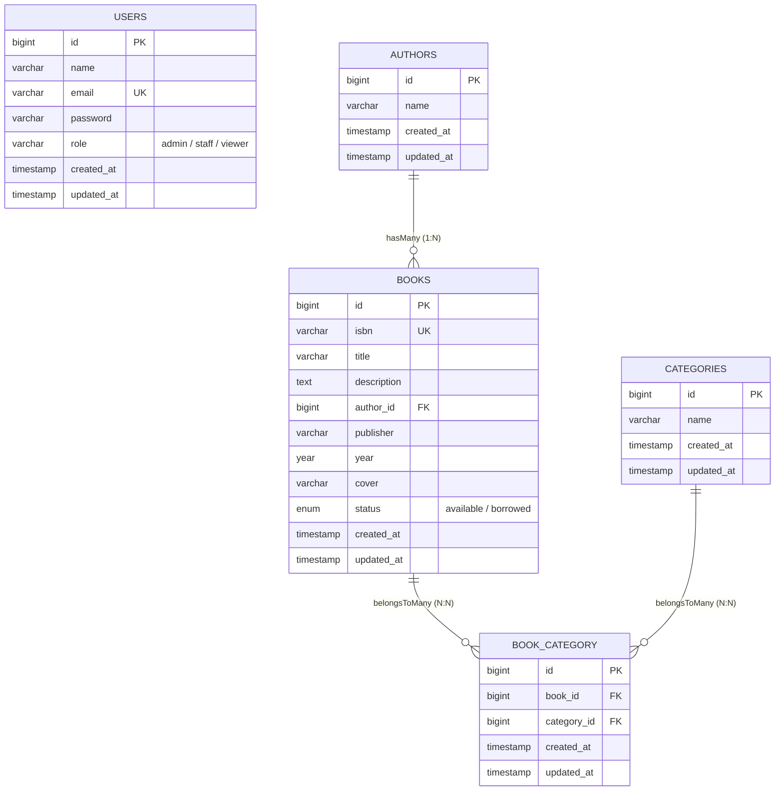

# Laporan Praktikum Pemrograman Berbasis Web
## Sistem Manajemen Buku Berbasis Laravel dan Filament 3.x

### Identitas Mahasiswa
- **Nama:** Muhammad Arya Alqadi
- **NPM:** 4524210058
- **Kelas:** PBW A
- **Mata Kuliah:** Pemrograman Berbasis Web
- **Dosen Pengampu:** Bambang Riono Arsad, S.Kom., MMSI

---

## Daftar Isi
1. [BAB I: Implementasi Sistem Dasar](#bab-i-implementasi-sistem-dasar)
2. [BAB II: Kustomisasi dan Pengembangan Fitur](#bab-ii-kustomisasi-dan-pengembangan-fitur)
3. [BAB III: Analisis Sistem dan Dokumentasi Teknis](#bab-iii-analisis-sistem-dan-dokumentasi-teknis)
   - [3.1 Arsitektur Basis Data dan Alur Sistem](#31-arsitektur-basis-data-dan-alur-sistem)
   - [3.2 Komparasi: Filament Admin Panel vs Pendekatan Tradisional](#32-komparasi-filament-admin-panel-vs-pendekatan-tradisional)
   - [3.3 Refleksi Pembelajaran dan Rencana Pengembangan](#33-refleksi-pembelajaran-dan-rencana-pengembangan)

---

## BAB I: Implementasi Sistem Dasar

Bagian ini memuat bukti tangkapan layar antarmuka aplikasi hasil instalasi, migrasi, *seeding*, dan pengujian operasi CRUD dasar.

### 1.1 Autentikasi dan Dasbor Pengguna
Tampilan antarmuka dasbor panel administrasi setelah pengguna berhasil melakukan proses autentikasi (login) menggunakan kredensial yang valid.

---

### 1.2 Tabel Data Buku dan Paginasi
Tampilan tabel utama pada menu *Books* yang menyajikan data buku hasil eksekusi *database seeder* sebanyak 50 entri data, lengkap dengan kolom ISBN, Judul, Penulis, Status, dan paginasi.

---

### 1.3 Formulir Penambahan Data Buku (Create Record)
Tampilan formulir input penambahan buku baru yang memuat input teks untuk ISBN dan judul, pemilihan penulis melalui *relational select* dengan fitur pembuatan penulis baru secara langsung (*inline*), tahun terbit, status ketersediaan, serta area unggah berkas sampul buku.

---

### 1.4 Pengujian Fitur Pencarian Data (Search)
Hasil eksekusi pencarian data buku secara dinamis pada tabel tanpa memuat ulang (*reload*) halaman penuh.

---

### 1.5 Pengujian Fitur Penyaringan (Filter)
Tampilan tabel ketika filter aktif diterapkan, seperti memfilter data buku berdasarkan status ketersediaan (*Available* atau *Borrowed*), tahun terbit, maupun nama penulis.

---

## BAB II: Kustomisasi dan Pengembangan Fitur

Pada bagian ini, dilakukan beberapa penyesuaian dan penambahan fungsionalitas di luar kebutuhan dasar sistem:

### 2.1 Penambahan Kolom Deskripsi Buku
- Struktur tabel `books` dimodifikasi dengan menambahkan kolom `description` bertipe `TEXT` (bersifat opsional/*nullable*).
- Atribut `$fillable` pada model `Book` diperbarui agar kolom deskripsi dapat menerima masukan secara *mass-assignment*.
- Formulir `BookResource` ditambahkan komponen `Textarea::make('description')` dengan ukuran penuh (*full-width span*).
- Kelas `BookFactory` disesuaikan untuk menghasilkan teks deskripsi realistis menggunakan generator `fake()->paragraph()`.

*(Tempatkan tangkapan layar form / detail deskripsi buku)*
<!--  -->

---

### 2.2 Penerapan Kontrol Akses Berbasis Peran (Role-Based Access Control)
- Struktur tabel `users` diperluas dengan kolom `role` yang mendukung tingkatan: `admin`, `staff`, dan `viewer`.
- Data pengguna awal (*seeder*) diperbarui untuk membuat akun representatif untuk tiap peran:
  - **Admin:** Memiliki seluruh hak akses operasional (melihat, menambah, mengubah, dan menghapus).
  - **Staff:** Memiliki hak akses operasional terbatas (melihat, menambah, dan mengubah; tombol hapus dinonaktifkan).
  - **Viewer:** Hanya memiliki hak akses membaca data (*read-only*; seluruh tombol aksi pembuatan, pengeditan, dan penghapusan dihilangkan).
- Seluruh aturan hak akses tersebut diintegrasikan ke dalam `BookPolicy` dan didaftarkan pada sistem otorisasi aplikasi.

*(Tempatkan tangkapan layar pengujian antarmuka untuk peran Staff dan Viewer)*
<!--  -->

---

### 2.3 Widget Statistik dan Visualisasi Dasbor
Panel dasbor diperkaya dengan komponen visual bawaan Filament:
- **`BookStatsOverview`:** Menampilkan kartu ringkasan berisi jumlah keseluruhan koleksi buku, total penulis, buku berstatus tersedia, dan buku yang sedang dipinjam.
- **`BookStatusChart`:** Menampilkan diagram donat (*doughnut chart*) untuk memvisualisasikan proporsi buku yang tersedia terhadap buku yang sedang dipinjam secara langsung dari basis data.

*(Tempatkan tangkapan layar widget dan grafik pada dasbor)*
<!--  -->

---

### 2.4 Sistem Relasi Kategori Buku (Many-to-Many)
- Dibuat tabel `categories` serta tabel penghubung (*pivot table*) `book_category` yang menerapkan relasi kunci asing (*foreign key*) dengan integritas referensial *cascade on delete*.
- Model `Book` dan `Category` dihubungkan menggunakan relasi Eloquent `belongsToMany`.
- Komponen input pada formulir `BookResource` dilengkapi dengan `Select` bertipe jamak (*multiple select*) yang terhubung ke relasi kategori, memungkinkan pemilihan beberapa kategori sekaligus untuk satu buku.

*(Tempatkan tangkapan layar pemilihan multi-kategori pada formulir buku)*
<!--  -->

---

## BAB III: Analisis Sistem dan Dokumentasi Teknis

### 3.1 Arsitektur Basis Data dan Alur Sistem

#### Diagram Hubungan Entitas (Entity Relationship Diagram)

#### Penjelasan Relasi Antar-Entitas
1. **Relasi Penulis dan Buku (`authors` ke `books` - One-to-Many):**
   Setiap buku diasosiasikan dengan tepat satu penulis, sedangkan seorang penulis dapat menulis beberapa judul buku. Relasi ini direpresentasikan melalui kolom `author_id` pada tabel `books`. Aturan `onDelete('cascade')` diterapkan agar apabila sebuah entri penulis dihapus, buku-buku yang terikat dengan penulis tersebut ikut terhapus demi menjaga konsistensi data.
2. **Relasi Buku dan Kategori (`books` ke `categories` - Many-to-Many):**
   Sebuah buku dapat dikelompokkan ke dalam beberapa genre atau kategori, dan satu kategori dapat mencakup banyak buku. Hubungan banyak-ke-banyak ini direalisasikan menggunakan tabel perantara `book_category` yang memuat pasangan kunci `book_id` dan `category_id`.
3. **Entitas Pengguna (`users`):**
   Tabel ini bertindak sebagai basis data autentikasi. Kolom `role` menentukan otorisasi pengguna saat berinteraksi dengan sumber daya di panel admin melalui mekanisme evaluasi *Policy*.

#### Alur Pemrosesan Permintaan (Request-to-Response Lifecycle)
1. **Permintaan Klien (Request):** Klien mengirimkan permintaan HTTP ke rute panel administrasi (contoh: `GET /admin/books`).
2. **Penyaringan Middleware:** Permintaan divalidasi oleh *middleware stack* Laravel, termasuk verifikasi sesi aktif dan pemeriksaan apakah pengguna telah terautentikasi.
3. **Inisialisasi Panel dan Otorisasi Sumber Daya:** Filament mengenali rute yang diminta dan memeriksa hak akses pengguna melalui method `viewAny()` pada `BookPolicy`. Permintaan ditolak (kode status HTTP 403) jika peran pengguna tidak diizinkan.
4. **Eksekusi Kueri Eloquent:** Komponen tabel mengeksekusi kueri teroptimasi dengan *eager loading* untuk memuat relasi `author` dan `categories`, mencegah timbulnya permasalahan performa *N+1 query*.
5. **Kompilasi Livewire dan Perenderan Blade:** Komponen dirender ke dalam bentuk HTML menggunakan struktur Blade terintegrasi dengan Livewire untuk mendukung interaktivitas asynchronous.
6. **Tanggapan Klien (Response):** Dokumen HTML dikirimkan kembali ke peramban. Interaksi lanjutan pengguna seperti pencarian atau pengurutan kolom ditangani melalui panggilan AJAX reaktif oleh Livewire tanpa memicu pemuatan ulang halaman secara menyeluruh.

---

### 3.2 Komparasi: Filament Admin Panel vs Pendekatan Tradisional

| Parameter Komparasi | Pendekatan Tradisional (Controller & Blade Manual) | Pendekatan Modern (Laravel & Filament 3.x) |
| :--- | :--- | :--- |
| **Waktu Siklus Pengembangan** | Memerlukan waktu relatif lama karena developer harus mendefinisikan rute, controller, form request, dan berkas view blade secara terpisah. | Sangat efisien; seluruh antarmuka tabel, formulir, dan validasi didefinisikan secara deklaratif dalam satu berkas *Resource*. |
| **Konsistensi Antarmuka Pengguna** | Bergantung sepenuhnya pada konsistensi penulisan CSS/HTML oleh pengembang, berpotensi menghasilkan UI yang bervariasi. | Memiliki konsistensi visual tinggi berkat integrasi komponen UI bawaan yang berbasis Tailwind CSS. |
| **Ketersediaan Fitur Bawaan** | Fungsionalitas seperti *real-time search*, *dynamic filtering*, *bulk delete*, paginasi, dan *modal preview* harus diprogram manual. | Seluruh fungsionalitas tabel modern telah tersedia secara bawaan dan siap digunakan melalui konfigurasi method chaining. |
| **Fleksibilitas Desain Antarmuka** | Bebas tanpa batasan konvensi; sangat ideal untuk antarmuka publik dengan arsitektur visual khusus. | Terikat pada struktur dan pola komponen dasbor admin; kurang cocok diaplikasikan pada *public-facing landing page*. |
| **Pemeliharaan Kode (*Maintenance*)** | Beban perawatan berkas tinggi karena kode tersebar di berbagai layer (Routes, Controller, Form Requests, Views). | Kode terpusat pada kelas *Resource*, mempermudah pelacakan dan modifikasi skema field di masa mendatang. |

#### Rekomendasi Penggunaan
- **Gunakan Filament ketika:** Aplikasi berfokus pada manajemen data internal (*back-office*), CMS, panel admin SaaS, atau saat proyek membutuhkan *Rapid Application Development* (RAD) dengan tenggat waktu singkat.
- **Gunakan Pendekatan Tradisional ketika:** Membangun antarmuka utama pengguna (*consumer-facing application*), sistem dengan alur bisnis yang sangat spesifik dan membutuhkan perancangan UI/UX kustom dari awal.

---

### 3.3 Refleksi Pembelajaran dan Rencana Pengembangan

#### Hal yang Dipelajari
- Konsep perancangan antarmuka secara deklaratif (*Declarative UI Paradigm*) dalam ekosistem PHP dan Livewire.
- Penerapan pemodelan basis data relasional kompleks (*One-to-Many* dan *Many-to-Many*) serta integrasinya ke dalam komponen formulir jamak.
- Implementasi prinsip keamanan aplikasi melalui pembatasan wewenang pengguna (*Role-Based Access Control*) menggunakan kelas *Policy*.
- Pemanfaatan komponen analitik berbasis widget untuk menyajikan visualisasi data yang informatif.

#### Kendala Teknis dan Penanganan Masalah
1. **Penerapan Fitur PHP 8 Attributes pada Laravel 12:**
   - *Kendala:* Struktur berkas model pada rilis Laravel terbaru menggunakan atribut PHP modern (`#[Fillable]`) menggantikan properti terlindungi konvensional.
   - *Solusi:* Mengadaptasi sintaks atribut dengan menyematkan kolom peran baru langsung ke dalam deklarasi atribut di atas definisi kelas model.
2. **Deteksi Karakter Byte Order Mark (BOM) pada Berkas Sumber:**
   - *Kendala:* Terjadi galat fatal penempatan *namespace* akibat adanya karakter tersembunyi UTF-8 BOM pada permulaan berkas PHP.
   - *Solusi:* Melakukan pembersihan karakter BOM secara terprogram pada seluruh berkas kode sumber PHP yang terdampak.
3. **Penyediaan Akses Tautan Berkas Statis (*Storage Symlink*):**
   - *Kendala:* Berkas citra sampul buku yang diunggah tidak dapat diakses langsung oleh peramban karena berada di direktori privat.
   - *Solusi:* Menjalankan perintah `php artisan storage:link` untuk merefleksikan direktori penyimpanan berkas publik ke direktori akar web.

#### Rencana Pengembangan Lanjutan
- **Sistem Sirkulasi dan Transaksi:** Mengembangkan modul peminjaman buku yang mencatat identitas peminjam, tanggal batas kembali, serta kalkulasi denda keterlambatan secara otomatis.
- **Pelaporan dan Ekspor Data:** Menyediakan utilitas pencetakan dokumen inventaris koleksi buku dalam format PDF dan spreadsheet (Excel).
- **Notifikasi Terjadwal:** Mengimplementasikan pengingat otomatis melalui surat elektronik (*email reminder*) bagi anggota perpustakaan yang mendekati tenggat waktu peminjaman.
